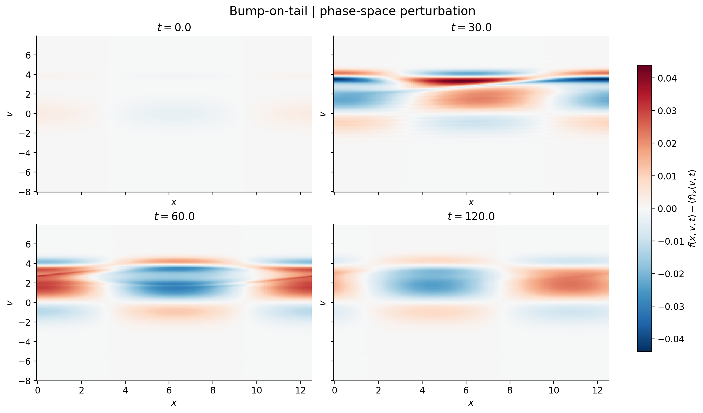
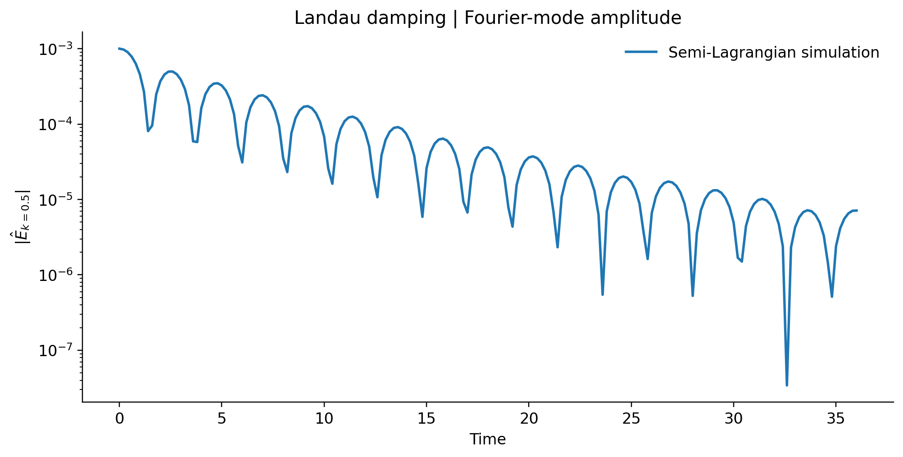

# Vlasov-Poisson

A Python solver for the one-dimensional, electrostatic Vlasov-Poisson system,
using a semi-Lagrangian scheme with Strang splitting.



## Features

- **Semi-Lagrangian advection** in position and velocity, with Strang splitting in time.
- **Pluggable interpolation**: linear or cubic spline, chosen per direction.
- **Spectral Poisson solver** for the self-consistent electric field (periodic domain).
- **Initial conditions** for Landau damping and the bump-on-tail instability.
- **Diagnostics**: electric-field energy, total particle number and total energy.
- **Linear theory**: plasma dispersion function, dispersion relation and dominant-mode
  root finding, used to compare simulated damping and growth rates with theory.



## Installation

```bash
git clone https://github.com/carlosovy/vlasov-poisson.git
cd vlasov-poisson
pip install -e ".[dev]"
```

## Quick start

```python
import numpy as np
from vlasov.config import Grid
from vlasov.initial_conditions import landau_damping
from vlasov.numerics import cubic_interpolate
from vlasov.solver import run

kx = 0.5
grid = Grid(xmin=0.0, xmax=2 * np.pi / kx, nx=64,
            vmin=-6.0, vmax=6.0, nv=128)

f0 = landau_damping(grid, epsilon=0.001, kx=kx)
f, el_energy, total_rho, total_energy = run(
    f0, grid, dt=0.1, nsteps=500,
    interp_x=cubic_interpolate, interp_v=cubic_interpolate,
)
```

`run` returns the distribution function at every step, plus the electric-energy,
particle-number and total-energy diagnostics.

## Notebooks

| Notebook | Contents |
| --- | --- |
| [`landau_damping`](notebooks/landau_damping.ipynb) | Linear Landau damping of a perturbed Maxwellian |
| [`bump-on-tail`](notebooks/bump-on-tail.ipynb) | Bump-on-tail instability and nonlinear saturation |
| [`growth_rate_comparison`](notebooks/growth_rate_comparison.ipynb) | Simulated growth rates vs. linear theory |
| [`dispersion_explorer`](notebooks/dispersion_explorer.ipynb) | Interactive dispersion-relation explorer (ipywidgets) |
| [`vlasov_visuals`](notebooks/vlasov_visuals.ipynb) | Summary figures |
| [`prototype/`](notebooks/prototype/) | The original single-notebook prototype this package grew from |

## Project layout

```
src/vlasov/
├── config.py              # Grid definition
├── initial_conditions.py  # Maxwellian, Landau damping, bump-on-tail
├── numerics.py            # Interpolation, advection, charge density, Poisson solve
├── solver.py              # Strang-split time stepping
├── diagnostics.py         # Energy and particle-number diagnostics
├── linear_theory.py       # Plasma dispersion function and dispersion relation
└── plotting.py            # Plotting helpers
tests/                     # pytest suite
docs/                      # Sphinx documentation
notebooks/                 # Examples and figures
```

## Tests

```bash
pytest               # full suite
pytest -m "not slow" # skip the longer simulations
```

## Documentation

API documentation is generated from the NumPy-style docstrings with Sphinx:

```bash
sphinx-build -b html docs docs/build
```

## Acknowledgements

The prototype in `notebooks/prototype/` uses a B-spline module (`bsl.py`) written by
[Pierre Navaro](https://github.com/pnavaro), from his
[Python/Fortran Vlasov-Poisson tutorial](https://pnavaro.github.io/python-fortran/04.vlasov-poisson.html#semi-lagrangian-method),
used under the MIT License (see the file header).

## License

[MIT](LICENSE)
